# Chess Repertoire

A personal chess opening trainer: build the lines you actually play, play them
against Stockfish, and have every move graded like Lichess's analysis board —
with a daily tactic and an annotated study library alongside it.

Next.js 15 · TypeScript · Tailwind 4 · Prisma 6 · SQLite · chess.js · react-chessboard · Stockfish 19 (WASM)

---

## What it does

| Build | Play | Review |
|---|---|---|
| Author a move tree, add branches, write notes, import PGN. Opening names and transpositions are detected as you walk the line. | Face Stockfish 19 at eight named levels, with a real clock (bullet → classical), an optional custom start position, a live evaluation bar, the captured pieces and material count beside each clock, take-backs and resign. Every finished game is saved. | Walk the line move by move; each move is graded **Brilliant · Great · Best · Excellent · Good · Book · Inaccuracy · Mistake · Blunder**, with colour, glyph, sound and a floating verdict. |

Plus a searchable **opening library**: 3,865 ECO lines, searchable by name,
code (`B90`) or move sequence (`1.e4 c5`), each previewable on a board.

### Learn

`/learn` is a curriculum, not a demo: 16 lessons in 5 chapters (Foundations,
Tactics, Checkmate patterns, Endgames, Openings), about two hours of material,
each lesson a real board that plays itself while a coach explains every move.
Where the lesson wants you to find the move, it hands you the board: wrong tries
are answered by a 260 ms Stockfish search ("that costs about 1.8 pawns, the
engine wants Bxf7+"), right ones move on. Each lesson ends with a drill
deep-link into the puzzle trainer, filtered to that pattern
(`/puzzles?theme=fork`).

Progress lives in `localStorage` — completed lessons, XP per lesson, a daily
streak, and the Pro entitlement. The Pro shelf (advanced mates, endgames,
openings) is gated by that flag rather than hard-coded: billing is not wired, so
the overview exposes a preview switch that shows exactly what a paywall would
lock.

Every lesson is replayed by `scripts/check-lessons.mts` before every build —
illegal moves, a mate that is not mate, or `say` text that is missing fails the
build.

### Openings, step by step

Pick any of the 3,865 lines and the board walks through it: play/pause, step
forward and back, jump to a move by clicking it, arrow keys for the same, `⇅`
to flip. Search takes several words at once ("sicilian najdorf" narrows instead
of widening), a whole or partial ECO code, or a move sequence that also pulls in
lines reaching the same position by another move order.

### Import a game

`/import` takes any PGN — a tournament export, a game from a book, a study — and
files it beside your own games. It goes through the same review pass as a played
game: Lichess-shaped accuracy, centipawn loss, a label on every move, an eval
graph you can click. Games brought in this way are listed under their PGN headers
(`Morphy, Paul — Duke Karl / Count Isouard`) with a `PGN` marker instead of an
opponent avatar.

### Opponents

The play screen has two panels, side by side (or stacked): **Play Stockfish**
— the bare engine on an eight-level ladder, no personality and no chat — and
**Play a character** — the same engine wearing a face and a handicap. Your
choice is remembered between visits, and "New game" reopens on it.

## The characters

Eight opponents, each a real Stockfish wearing a handicap: how long it thinks, how wide it looks, and how often it settles for one of its other candidate moves. Skill Level 0 alone still beats beginners, so the low levels lean on that last dial.

| Character | Rating | Style |
| --- | --- | --- |
| Pip | ≈450 | Absolute beginner — hangs pieces, loves pawn moves |
| Bella | ≈750 | Eager improver |
| Rusty | ≈1000 | Gambit addict |
| Marlow | ≈1350 | Quiet positional |
| Kestrel | ≈1650 | Tactical hawk |
| Sable | ≈1950 | Cold calculator |
| Vex | ≈2200 | Chaos agent |
| Titan | ≈2600 | Full strength, no handicap |

Each has a portrait, a personality, and a chat panel during the game: they greet you, react to captures, checks and promotions, comment when the game ends, and answer a few things you type back.

## Playing the engine

Start a game in one of three ways on **Play**: click a quick-pairing tile (1+0 … 10+0 or untimed) to begin immediately at Club level with a random colour; or set the opponent level, the clock, your colour and the starting position in the *New game* card and press **Start game**. Any repertoire's Play tab starts the same way. Pawns that reach the last rank open a promotion picker instead of silently becoming a queen.

The review is the full analysis station: every move carries a grade badge **on the square the piece landed on** (?!, ??, !, !!), an eval number in the move list, a green arrow to the move that should have been played, and an eval graph whose coloured dots mark every blunder, mistake, inaccuracy, Great and Brilliant — click any point to jump there. `?ply=6` on a game URL opens it already on the sixth move.

When a game ends, a card over the board offers **Analyse this game**, **Rematch** or **Study the position**. The stored game opens with every move graded — Book, Best, Excellent, Good, Inaccuracy, Mistake, Blunder, Great, Brilliant — plus accuracy and average centipawn loss per side.

**Play** (`/play`, in the nav) is the front door: a *quick pairing* row that
drops you into a game in one click — 1+0, 3+0, 3+2, 5+3, 10+0, or no clock, at
the currently selected level — and a *custom game* card whose **Start game**
button sits in its header, so it is visible before you scroll. The same screen
is reachable from each repertoire's Play tab, when you want to face the engine
from that repertoire's colours.

Every game starts from the same three decisions:

| Setting | What it does |
|---|---|
| **Opponent** | Eight named levels (Novice ≈800 … Maximum ≈2900). A level sets Stockfish's *Skill Level* and its thinking time together, so it is weak in two ways at once, not just slow. Ratings are rough indicators, not measurements. |
| **Time control** | Bullet 1+0 / 2+1, Blitz 3+0 / 3+2 / 5+0 / 5+3, Rapid 10+0 / 10+5 / 15+10, Classical 30+0, or no clock. Increment is added after the move that earned it. |
| **Game type** | Standard, or **from a FEN** — start from any legal position (endgames, a middlegame you want to replay), validated by chess.js before the board opens. |

The clock runs for the side to move, **including while Stockfish thinks**, and
flagging loses the game: "You ran out of time" or "Stockfish ran out of time".
A custom-start game is stored with `FEN`/`SetUp` PGN headers and replayed
server-side from that position — otherwise the first black move would be
rejected as illegal and the record would be silently truncated.

### Games you played

Play → resign or get mated, and the game lands in **Games** (`/games`) as a
PGN with result, colour, opponent skill and move count. Open one and you get
the same review board: ← / → walks the game, each move is graded, and the
sidebar offers the PGN for export.

Games are stored by replaying the move list server-side with chess.js, so a
corrupted client cannot write an illegal game into the record. The review pass
then writes **accuracy** and **average centipawn loss** back onto that row:

- accuracy = the mean of per-move scores on the published win-percentage curve
  (`winPercent(cp) = 50 + 50 · (2/(1+e^(−0.00368208·cp)) − 1)`, then
  `103.1668 · e^(−0.04354·swing) − 3.1669`), clipped to 0–100
- ACPL = mean centipawn loss per colour

Opening moves are excluded from both: an unplayed Houdini line is not evidence
of skill. And a move is not "Book" merely because its position is in the ECO
table — `2.Ke2` is the Bongcloud and still costs a queen's worth of advantage,
so it is graded on what it costs.

### Puzzles and community

| Puzzles | Community |
|---|---|
| A fresh tactic every day from Lichess's public API, plus an **offline library of 30,000 tactics** imported from Lichess's public puzzle database. Practice difficulty tracks your Elo, and every attempt moves a rating (K = 40 / 32 / 24). Streak and accuracy stored in SQLite. | Annotated games (Morphy 1858, Anderssen 1851, Légal's trap) plus **your own games, published from the review page**. Search by title, idea or author, sort by newest / most discussed / A–Z, step through with ← / →, pin a note to the exact move you are looking at, jump back to any annotated position, or copy the whole game into a new repertoire in one click. |

### Real accounts, and a real Lichess feed

The community used to be a seeded library with a name-typed comment box. It now
has accounts and a live feed:

- **Accounts** — `/signup` creates a user (email + public handle + password).
  Passwords are salted and hashed with `scrypt`; sessions are random tokens in
  the `Session` table, carried in an `httpOnly` cookie, and expire after 30 days.
  Reading the community never needs an account; publishing a study, writing a
  note and unpublishing your own study do.
- **Ownership** — a study stores `userId`, so "Unpublish" only appears for the
  account that published it. Seeded and imported studies have no owner and
  cannot be deleted from the UI.
- **Lichess import** — `scripts/import-lichess.mjs` pulls finished standard
  games from (1) broadcast rounds of top events and (2) the arena tournaments
  that just finished, replays every PGN with chess.js, keeps the strongest by
  average Elo, and stores them with `source = "lichess"`, the opener name, both
  ratings and a link back to the game. Each game is keyed by its Lichess id, so
  running the import twice never duplicates anything. The shelf rotates: past
  220 imported games, the oldest ones without comments are dropped.
- **Every morning** — a launchd agent
  (`~/Library/LaunchAgents/com.cjpeng.chess-lichess.plist`) runs
  `scripts/run-lichess-import.sh` at 07:20, logging to `/tmp/chess-lichess.log`.
  Run it by hand with `npm run lichess:import`.

The community index filters by source (All / Lichess / Players), by author, and
sorts by newest, most discussed or A–Z.

### The puzzle library

`npm run db:puzzles` streams Lichess's 5M-row puzzle archive through `zstd`,
keeps tactics in a usable rating band with short solutions, replays each line
with chess.js to prove it is legal, and bulk-inserts them into SQLite. It is
additive — run it again with `-- --count=60000` to take more. Nothing is
fetched at play time.

```bash
curl -L -o .cache/lichess_db_puzzle.csv.zst \
  https://database.lichess.org/lichess_db_puzzle.csv.zst
npm run db:puzzles                       # 30,000 tactics, ratings 700-2400
npm run db:puzzles -- --count=60000      # top up later
```

Two details worth knowing, because the archive is not shaped like you expect:

1. The stored FEN is the position **before the opponent's setup move**, and
   that move is listed first. `Qxh5 Qg2#` with White to move is not "White
   mates" — it is White's Qxh5, then the solver (Black) answers Qg2#. The
   importer plays the setup move first, so the board you see is always yours.
2. The archive sometimes appends the move that ended the real game. Lines are
   truncated at checkmate.

Both are deliberately local-first: there is no server and no account. The
library ships with the app and the threads live in your own database — seeded
comments are sample content.

### Development timeline

`docs/development-timeline.png` is generated from `git log` by
`scripts/dev-timeline.py` — every commit, its local time, and the phase it belongs
to. Two things keep it current, so nothing has to be remembered:

- `.githooks/post-commit` regenerates it after every commit and stages the image
  (enable once with `git config core.hooksPath .githooks`).
- A launchd agent (`~/Library/LaunchAgents/com.cjpeng.chess-timeline.plist`) reruns
  it every day at 21:40 even when there are no new commits.

Commits whose message contains "timeline" are filtered out of the diagram, so a
refresh never counts itself. `scripts/run-dev-timeline.sh` picks whichever Python
on the machine actually has Pillow (Homebrew's Python ships without it).

## Screenshots

| Build | Opening library |
|---|---|
|  |  |

| Play vs Stockfish | Review with grading |
|---|---|
|  |  |

| Game history | Reviewing a saved game |
|---|---|
| 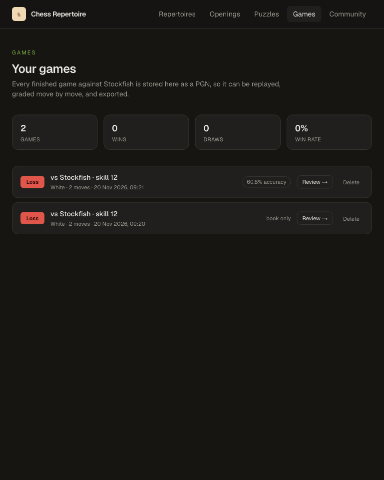 | 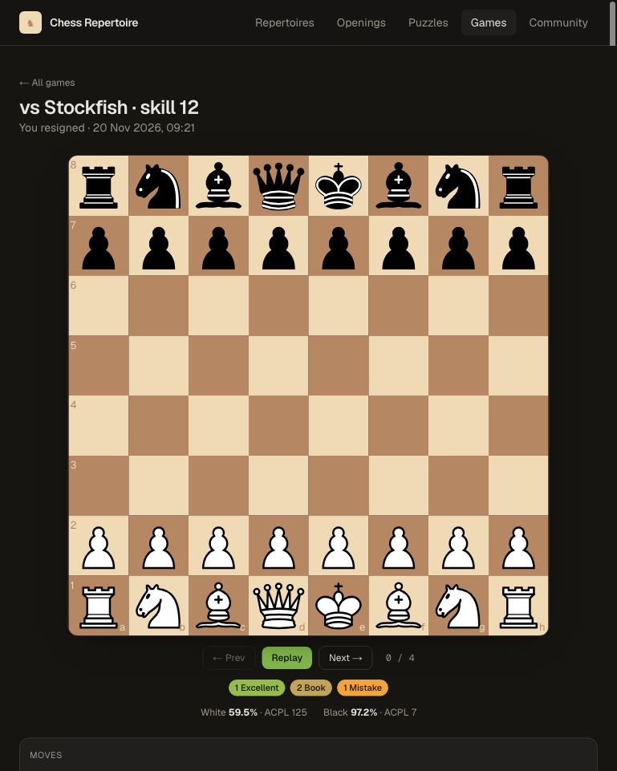 |

| New game: level, clock, start |
|---|
| 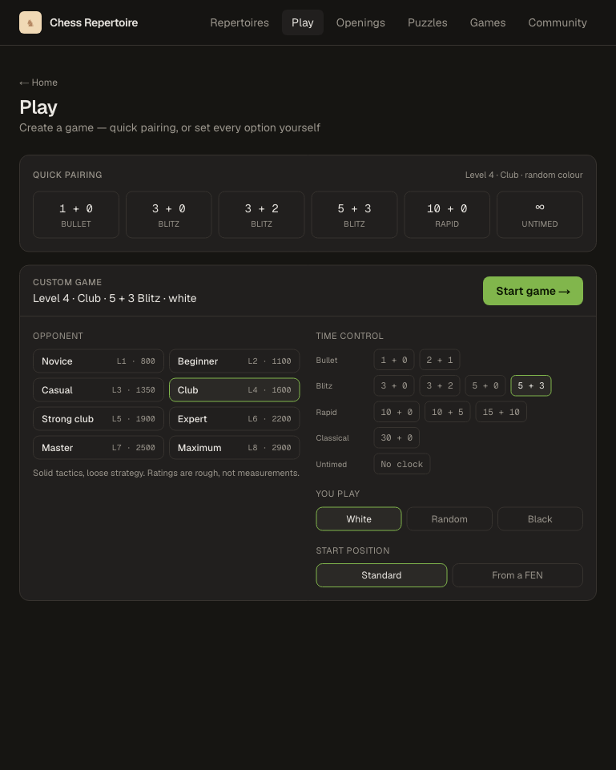 | 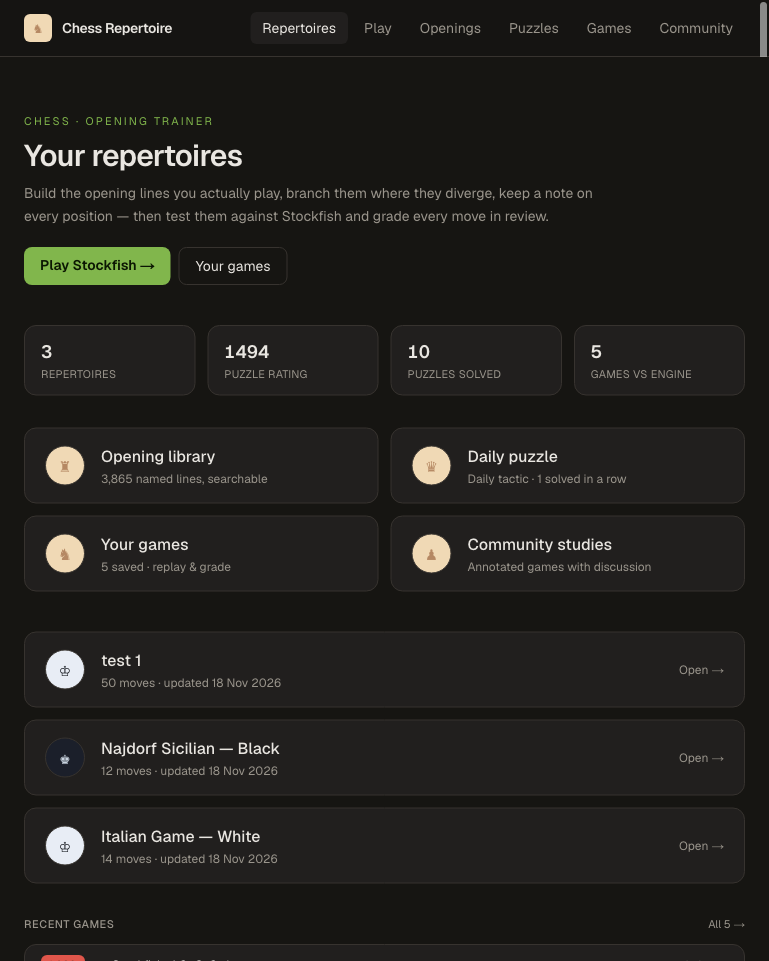 |
| 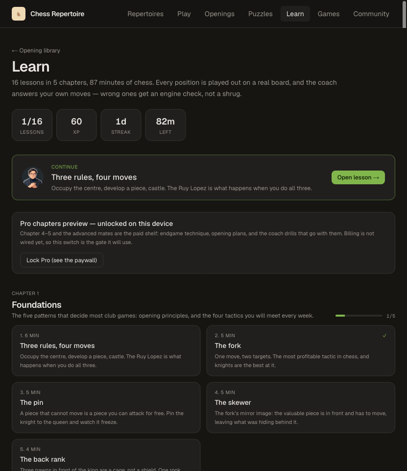 | 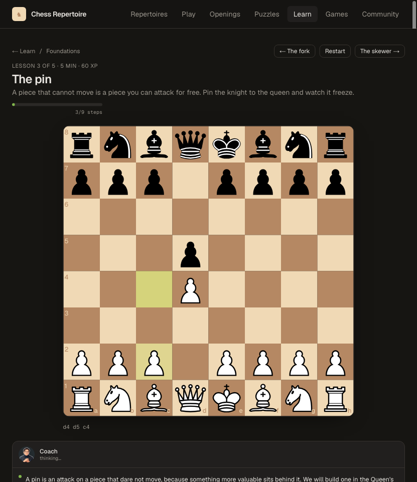 |
| 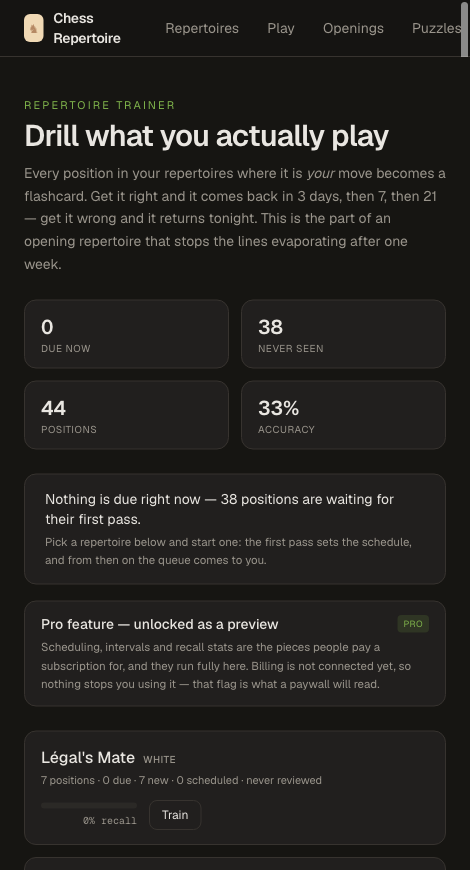 | 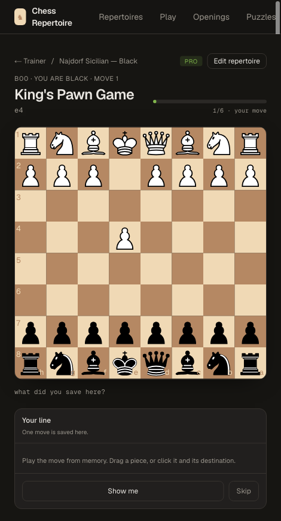 |

| Community, with Lichess games | A real Lichess game |
|---|---|
| 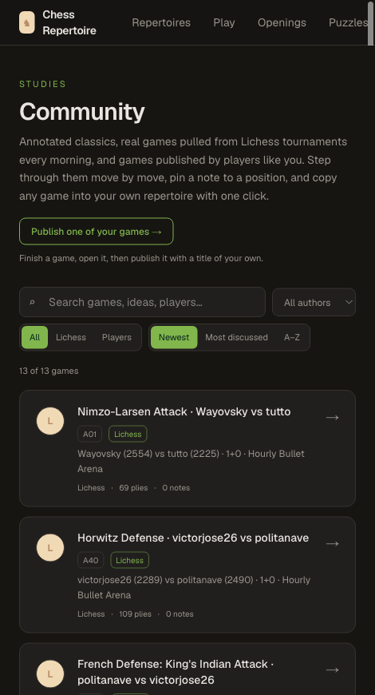 | 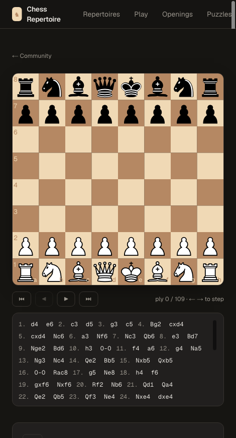 |
| **Accounts** | |
| 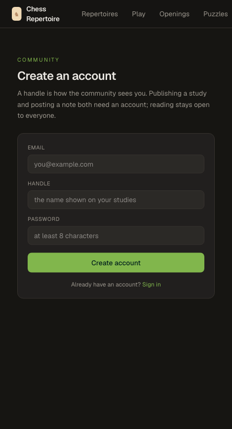 | |

---

## Quick start

```bash
git clone https://github.com/<your-username>/Chess-Repertoire_App.git
cd Chess-Repertoire_App
npm install
cp .env.example .env   # points at a local SQLite file
npm run db:setup       # database + 2 sample repertoires + 3,865 openings + puzzles and studies
npm run dev            # http://localhost:3000
```

Requires Node.js 20+. No engine binary, no external account, no API key —
Stockfish is copied out of `node_modules` automatically by `predev` / `prebuild`,
and community accounts are created locally in your own database.

### Commands

| Command | Does |
|---|---|
| `npm run dev` | Dev server |
| `npm run build` | Production build (also type-checks) |
| `npm run db:studio` | Prisma Studio — browse the tables |
| `npm run db:openings` | Re-download the Lichess ECO table (needs network) |
| `npm run db:seed` | Recreate the two sample repertoires |
| `npm run db:content` | Load the built-in seeded puzzles and study library |
| `npm run lichess:import` | Pull today's real Lichess games into the community (network) |
| `npm run db:puzzles` | Import tactics from Lichess's puzzle archive (needs `.cache/…csv.zst`) |
| `npm run db:reset` | Wipe + migrate + reseed everything |

---

## How it works

```
src/
├─ app/
│  ├─ page.tsx                 dashboard
│  ├─ openings/page.tsx        opening library
│  ├─ r/[id]/page.tsx          build mode
│  ├─ r/[id]/play/page.tsx     play vs Stockfish
│  ├─ r/[id]/review/page.tsx   grading / replay
│  └─ actions.ts               every server action (the whole backend)
├─ components/                  RepertoireBuilder · PlayVsEngine · ReviewSequence · OpeningsExplorer
└─ lib/
   ├─ chess.ts                 move helpers + normalizedFen
   ├─ engine.ts                UCI client over a Worker
   ├─ classify.ts              centipawn-loss grading
   ├─ sound.ts                 Web Audio cues (no asset files)
   └─ boardTheme.ts            one palette for every board
```

Three ideas carry most of the weight:

**1. A position key.** `Node.normFen` is a FEN with the halfmove clock and move
number stripped. The same position reached by a different move order hashes
identically — that is what makes transposition detection an indexed lookup
instead of a comparison loop.

**2. The tree lives in one table.** `Node` stores the move that *leads to it*
(`san`, `uci`) plus the resulting `fen`, with `@@unique([parentId, uci])`. The
root is a real row, so every traversal is uniform and `addMove` is idempotent.

**3. Grading is arithmetic on engine scores.** The engine scores from the side
to move, so a move's cost is `best - (-score_after)`:

| Centipawn loss | Grade |
|---|---|
| 0 | Best |
| ≤ 20 | Excellent |
| ≤ 60 | Good |
| ≤ 120 | Inaccuracy |
| ≤ 250 | Mistake |
| > 250 | Blunder |

`Brilliant` additionally requires the best move *and* a material sacrifice;
`Great` requires the best move to beat the second-best by ≥ 1.5 pawns (hence
`MultiPV 2`). Full derivation in [docs/BUILD-NOTES.md](docs/BUILD-NOTES.md).

---

## Known limits

- Promotion auto-queens (no picker yet).
- Analysis runs on demand; a 60-move game takes roughly ten seconds at 600 ms
  per position, then it is cached.
- Spaced-repetition drilling (`Review` table exists, unused) is the next milestone.
- Stockfish here is the **lite** build: ~250 Elo below full Stockfish, but 1.8 MB and no COOP/COEP headers.

## Roadmap

1. Spaced repetition — `/r/[id]/train`, due cards, SM-2 scheduling.
2. "Use this line" — create a repertoire straight from a library entry.
3. PGN export with nested variations.
4. Real tree sidebar with collapsible variations.

---

## Licence & credits

Code is [MIT](LICENSE).

- [Stockfish](https://github.com/official-stockfish/Stockfish) — GPL-3.0. The WASM
  binary is **not** vendored here; `scripts/copy-engine.mjs` copies it from the
  `stockfish` npm package at build time, and it stays under GPL-3.0.
- [lichess-org/chess-openings](https://github.com/lichess-org/chess-openings) —
  public domain (CC0). Every ECO name, code and line in the library comes from it.
- [chess.js](https://github.com/jhlywa/chess.js) (BSD-2) and
  [react-chessboard](https://github.com/Clariity/react-chessboard) (MIT).
