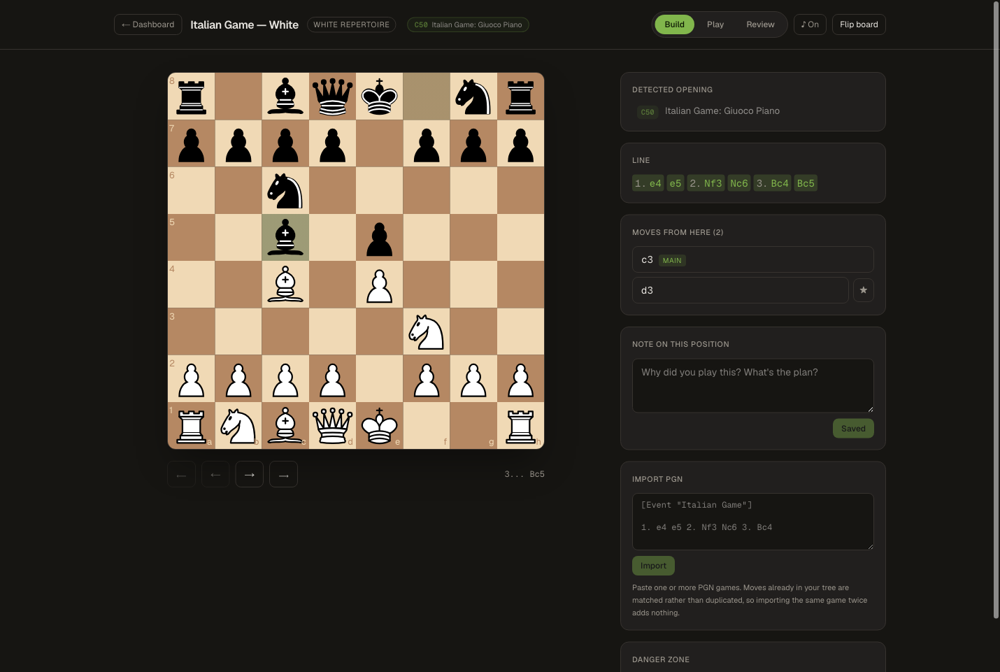
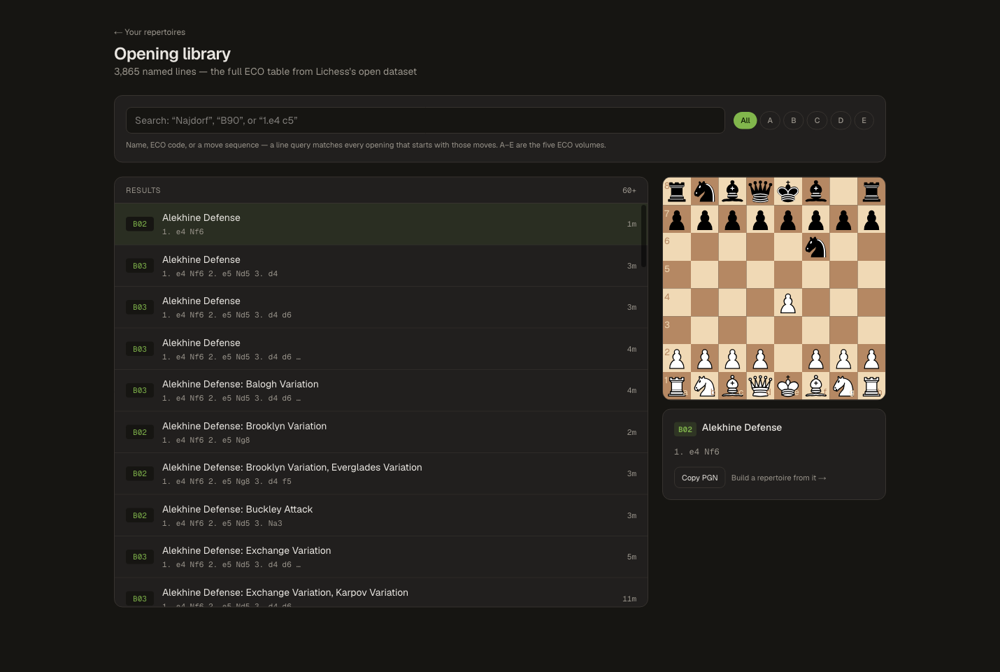
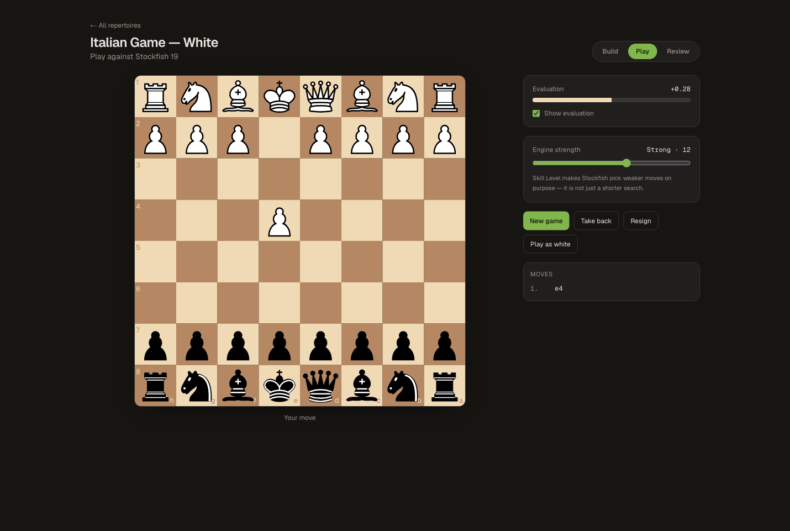
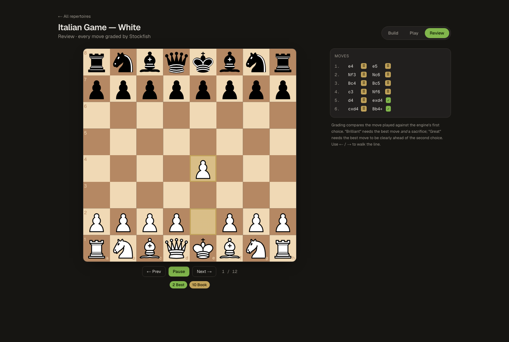

# Chess Repertoire

A personal chess opening trainer: build the lines you actually play, play them
against Stockfish, and have every move graded like Lichess's analysis board.

Next.js 15 · TypeScript · Tailwind 4 · Prisma 6 · SQLite · chess.js · react-chessboard · Stockfish 19 (WASM)

---

## What it does

| Build | Play | Review |
|---|---|---|
| Author a move tree, add branches, write notes, import PGN. Opening names and transpositions are detected as you walk the line. | Face Stockfish 19 with an adjustable skill level, a live evaluation bar, take-backs and resign. | Walk the line move by move; each move is graded **Brilliant · Great · Best · Excellent · Good · Book · Inaccuracy · Mistake · Blunder**, with colour, glyph, sound and a floating verdict. |

Plus a searchable **opening library**: 3,865 ECO lines, searchable by name,
code (`B90`) or move sequence (`1.e4 c5`), each previewable on a board.

### Screenshots

| Build | Opening library |
|---|---|
|  |  |

| Play vs Stockfish | Review with grading |
|---|---|
|  |  |

---

## Quick start

```bash
git clone https://github.com/<your-username>/Chess-Repertoire_App.git
cd Chess-Repertoire_App
npm install
cp .env.example .env   # points at a local SQLite file
npm run db:setup       # create the database, seed 2 sample repertoires + 3,865 openings
npm run dev            # http://localhost:3000
```

Requires Node.js 20+. No engine binary, no account, no API key — Stockfish is
copied out of `node_modules` automatically by `predev` / `prebuild`.

### Commands

| Command | Does |
|---|---|
| `npm run dev` | Dev server |
| `npm run build` | Production build (also type-checks) |
| `npm run db:studio` | Prisma Studio — browse the tables |
| `npm run db:openings` | Re-download the Lichess ECO table (needs network) |
| `npm run db:seed` | Recreate the two sample repertoires |
| `npm run db:reset` | Wipe + migrate + reseed everything |

---

## How it works

```
src/
├─ app/
│  ├─ page.tsx                 dashboard
│  ├─ openings/page.tsx        opening library
│  ├─ r/[id]/page.tsx          build mode
│  ├─ r/[id]/play/page.tsx     play vs Stockfish
│  ├─ r/[id]/review/page.tsx   grading / replay
│  └─ actions.ts               every server action (the whole backend)
├─ components/                  RepertoireBuilder · PlayVsEngine · ReviewSequence · OpeningsExplorer
└─ lib/
   ├─ chess.ts                 move helpers + normalizedFen
   ├─ engine.ts                UCI client over a Worker
   ├─ classify.ts              centipawn-loss grading
   ├─ sound.ts                 Web Audio cues (no asset files)
   └─ boardTheme.ts            one palette for every board
```

Three ideas carry most of the weight:

**1. A position key.** `Node.normFen` is a FEN with the halfmove clock and move
number stripped. The same position reached by a different move order hashes
identically — that is what makes transposition detection an indexed lookup
instead of a comparison loop.

**2. The tree lives in one table.** `Node` stores the move that *leads to it*
(`san`, `uci`) plus the resulting `fen`, with `@@unique([parentId, uci])`. The
root is a real row, so every traversal is uniform and `addMove` is idempotent.

**3. Grading is arithmetic on engine scores.** The engine scores from the side
to move, so a move's cost is `best - (-score_after)`:

| Centipawn loss | Grade |
|---|---|
| 0 | Best |
| ≤ 20 | Excellent |
| ≤ 60 | Good |
| ≤ 120 | Inaccuracy |
| ≤ 250 | Mistake |
| > 250 | Blunder |

`Brilliant` additionally requires the best move *and* a material sacrifice;
`Great` requires the best move to beat the second-best by ≥ 1.5 pawns (hence
`MultiPV 2`). Full derivation in [docs/BUILD-NOTES.md](docs/BUILD-NOTES.md).

---

## Known limits

- Promotion auto-queens (no picker yet).
- Review grades the stored main line; reviewing an arbitrary pasted game is not wired up.
- Spaced-repetition drilling (`Review` table exists, unused) is the next milestone.
- Stockfish here is the **lite** build: ~250 Elo below full Stockfish, but 1.8 MB and no COOP/COEP headers.

## Roadmap

1. Spaced repetition — `/r/[id]/train`, due cards, SM-2 scheduling.
2. "Use this line" — create a repertoire straight from a library entry.
3. PGN export with nested variations.
4. Real tree sidebar with collapsible variations.

---

## Licence & credits

Code is [MIT](LICENSE).

- [Stockfish](https://github.com/official-stockfish/Stockfish) — GPL-3.0. The WASM
  binary is **not** vendored here; `scripts/copy-engine.mjs` copies it from the
  `stockfish` npm package at build time, and it stays under GPL-3.0.
- [lichess-org/chess-openings](https://github.com/lichess-org/chess-openings) —
  public domain (CC0). Every ECO name, code and line in the library comes from it.
- [chess.js](https://github.com/jhlywa/chess.js) (BSD-2) and
  [react-chessboard](https://github.com/Clariity/react-chessboard) (MIT).
